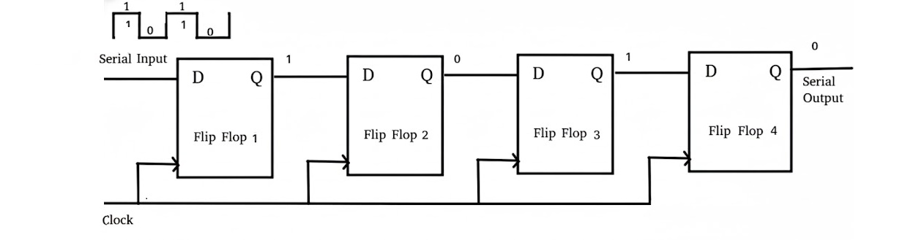
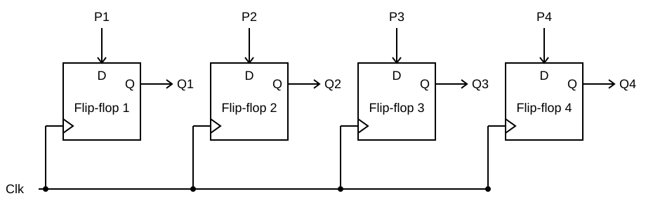

### Practice

The Practice page has two tasks, one for each tab: **SISO Shift Register** and **PIPO Register**. In both tasks the input bits, the clock Clk and the output bits are already on the circuit board, and you build the register between them from D flip-flops. There is no demo page for this experiment.

#### General instructions

- Click on **D Flip-Flop** in the **Components** panel to add a flip-flop to the board, drag it to move it, and connect components by dragging from one endpoint (the dots) to another. A wire can be dragged from an output point to an input point or the other way round. An output point can drive several inputs: the clock Clk has to be connected to all four flip-flops. An input point takes one wire only.
- The D flip-flop has the input points **D** (data) and **Clk** (clock, marked with a triangle) and the output points **Q** (upper) and **Q'** (lower). Q is the one used in these tasks.
- To delete a wire or a component, right click on it and select **Delete**.
- Click on an input bit to toggle it between 1 and 0. The clock Clk is a separate input: its value changes by itself while the simulation runs.
- The D flip-flop is **positive-edge triggered**: it copies D to Q when Clk goes from 0 to 1, and keeps its value otherwise. Every flip-flop starts with Q = 1.
- Click on **Simulate** to start the clock Clk (it rises every 2 seconds). The output bits are shown with their starting value 1 at once and change at every rising edge of the clock. The button now reads **Stop**: click on it to stop the clock. **Reset** stops the clock too, and so does a change of tab. The **Submit** button works only when the clock is stopped.
- Click on **Submit** to check the circuit. A "Success" or "Fail" message and a table with the expected and the observed output values are shown. The circuit must be completely connected, otherwise the component that is not connected properly is highlighted.

#### Task 1: 4-bit Serial Input Serial Output (SISO) Shift Register

_Figure 1: 4-bit SISO shift register: 4 D flip-flops connected in series with a common clock input. Reference: Theory section_

**Components required:** 4 D flip-flops. The input bits D (serial input) and Clk (clock) and the output bits Q1, Q2, Q3 and Q4 are on the board; Q1 to Q4 are the outputs of the four stages, from the one that receives D to the last one.

**Circuit connections:**

1. Drag the first D Flip-Flop and connect its Clk input point to the **Clk** input bit and its D input point to the **D** input bit. Connect its Q output point to the **Q1** output bit.
2. Drag the second D Flip-Flop and connect its Clk input point to the **Clk** input bit and its D input point to the Q output point of the first D Flip-Flop. Connect its Q output point to the **Q2** output bit.
3. Drag the third D Flip-Flop and connect its Clk input point to the **Clk** input bit and its D input point to the Q output point of the second D Flip-Flop. Connect its Q output point to the **Q3** output bit.
4. Drag the fourth D Flip-Flop and connect its Clk input point to the **Clk** input bit and its D input point to the Q output point of the third D Flip-Flop. Connect its Q output point to the **Q4** output bit.
5. Set the value of D (click on it to toggle), click on **Simulate** and watch the outputs Q1, Q2, Q3 and Q4 change at the rising edges of Clk. Change D between the clock pulses to send different bits through the register.

**Expected behaviour** (checked when you click on "Submit", starting from Q1 = Q2 = Q3 = Q4 = 1). A row with Clk = 1 applies one complete clock pulse with the D of the row:

| D | Clk | Q1 | Q2 | Q3 | Q4 | Operation                                  |
| - | --- | -- | -- | -- | -- | ------------------------------------------ |
| 0 | 0   | 1  | 1  | 1  | 1  | Hold                                       |
| 1 | 0   | 1  | 1  | 1  | 1  | Hold (no clock pulse)                      |
| 0 | 1   | 0  | 1  | 1  | 1  | 0 enters Q1                                |
| 1 | 1   | 1  | 0  | 1  | 1  | 1 enters Q1, the 0 moves to Q2             |
| 0 | 1   | 0  | 1  | 0  | 1  | 0 enters Q1, the 0 moves to Q3             |
| 1 | 1   | 1  | 0  | 1  | 0  | the first 0 reaches Q4                     |
| 1 | 1   | 1  | 1  | 0  | 1  | the data keeps moving                      |

#### Observations

- When Clk is 0, or does not change, all output bits remain unchanged. When Clk goes from 0 to 1 (positive edge), the data moves through the register by one position.
- **Data flow**: Q1 shows the most recent input, Q2 shows the data delayed by 1 clock pulse, Q3 delayed by 2 clock pulses and Q4 delayed by 3 clock pulses.
- A bit entered at D appears at Q4 after 4 clock pulses.
- If the circuit has been made as described above, a "Success" message is displayed upon clicking "Submit".

#### Task 2: 4-bit Parallel Input Parallel Output (PIPO) Register

_Figure 2: 4-bit PIPO register: 4 D flip-flops with parallel inputs P1 to P4, parallel outputs Q1 to Q4 and a common clock. Reference: Theory section_

**Components required:** 4 D flip-flops. The input bits P4, P3, P2, P1 and Clk and the output bits Q4, Q3, Q2, Q1 are on the board (the highest bit is on the left).

**Circuit connections:**

1. Drag the first D Flip-Flop and connect its Clk input point to the **Clk** input bit and its D input point to the **P1** input bit. Connect its Q output point to the **Q1** output bit.
2. Drag the second D Flip-Flop and connect its Clk input point to the **Clk** input bit and its D input point to the **P2** input bit. Connect its Q output point to the **Q2** output bit.
3. Drag the third D Flip-Flop and connect its Clk input point to the **Clk** input bit and its D input point to the **P3** input bit. Connect its Q output point to the **Q3** output bit.
4. Drag the fourth D Flip-Flop and connect its Clk input point to the **Clk** input bit and its D input point to the **P4** input bit. Connect its Q output point to the **Q4** output bit.
5. Set the values of P1, P2, P3 and P4 (click on each to toggle), click on **Simulate** and watch the outputs Q1 to Q4 take the values of the inputs at the rising edges of Clk.

**Expected behaviour** (checked when you click on "Submit", starting from Q = 1111). A row with Clk = 1 applies one complete clock pulse:

| P1 | P2 | P3 | P4 | Clk | Q1 | Q2 | Q3 | Q4 | Operation                    |
| -- | -- | -- | -- | --- | -- | -- | -- | -- | ---------------------------- |
| 0  | 0  | 0  | 0  | 0   | 1  | 1  | 1  | 1  | Hold                         |
| 1  | 0  | 1  | 0  | 0   | 1  | 1  | 1  | 1  | Hold (no clock pulse)        |
| 1  | 0  | 1  | 0  | 1   | 1  | 0  | 1  | 0  | P1 to P4 are loaded          |
| 0  | 1  | 0  | 1  | 0   | 1  | 0  | 1  | 0  | Hold, the inputs are ignored |
| 0  | 1  | 0  | 1  | 1   | 0  | 1  | 0  | 1  | New values are loaded        |
| 0  | 0  | 1  | 1  | 0   | 0  | 1  | 0  | 1  | Hold                         |

#### Observations

- When Clk is 0, or does not change, the output bits Q1 to Q4 remain unchanged, whatever the inputs P1 to P4 are. When Clk goes from 0 to 1 (positive edge), all the parallel inputs are loaded into their flip-flops at the same time.
- All 4 bits are stored in a single clock cycle: Q1 = P1, Q2 = P2, Q3 = P3 and Q4 = P4.
- If the circuit has been made as described above, a "Success" message is displayed upon clicking "Submit".

#### Troubleshooting

- **"Highlighted component not connected properly" or "D of D Flip Flop not connected properly"**: the D input and the Clk input of every flip-flop have to be connected, and every output bit has to be driven by a flip-flop.
- **Submit does not respond**: Submit is disabled while the clock runs. Click on "Stop" first.
- **The outputs do not change in the simulation**: they change only at the rising edge of Clk, that is, once every 2 seconds, and only if Clk is connected to the flip-flops.
- **The fail message appears in the SISO task**: check that the output points Q of the flip-flops are connected to the output bits in the right order (Q1 to the first flip-flop, which receives D) and that the D input of each flip-flop comes from the Q of the previous one.
